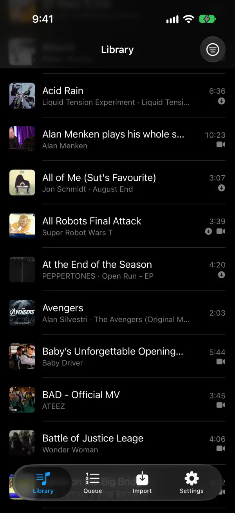
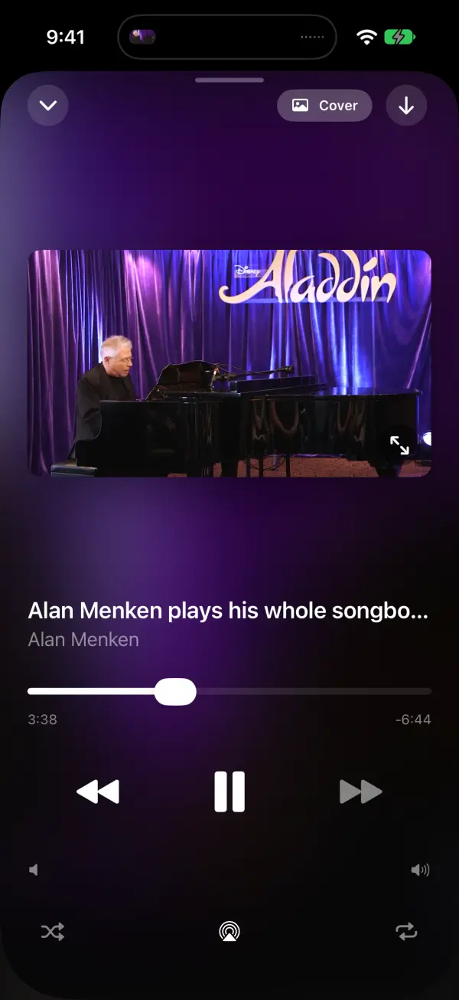
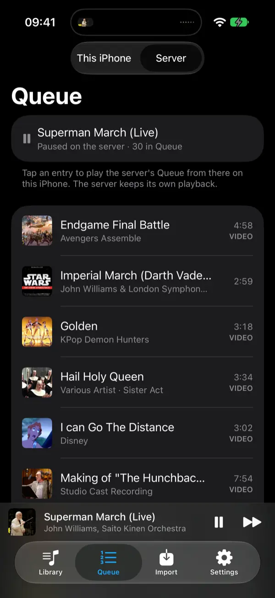

<div align="center">
  
  <h1>vtamp</h1>
  <p><strong>A music player for the terminal that keeps playing after you detach.</strong></p>
  <p>Local files and live radio. One persistent playback server, any number of terminal clients, and a JSON CLI for scripts and agents. Rust. macOS first.</p>
</div>

<p align="center">
  <a href="site/screenshots/compact-queue.png">
    
  </a>
</p>

There used to be a little player on the corner of your desktop. A playlist, an album cover, a green display. It did one thing, and it felt like yours.

These days, a lot of us live in a terminal. We still want that player. We just don't want it to own a tmux pane for the rest of the day.

**vtamp** brings a little **v**irtual **t**erminal and a little Win**amp** spirit together. Its playback server keeps the music going; its interface comes and goes. Open it, pick a track, press `q`, get back to work. Come back from another pane whenever you like.

```text
$ vtamp                   # Start the server if needed. Attach the player.
                          # Pick a track. Press Enter. Press q to detach.
$ vtamp next              # Change tracks without opening the interface.
$ vtamp pause             # Make some room for a conversation.
$ vtamp                   # Same server. Same queue. Pick up where it is now.
```

No account. No streaming subscription. No permanent pane. Your music stays on your machine.

Away from the desk, the [iPhone app](#iphone-app) and [Android app](#android-app) connect to the same server over a private network such as Tailscale, browse its Library, and play the tracks and their saved videos on the phone.

On an Apple Silicon Mac, `brew install rath/tap/vtamp` is all it takes; see [Install](#install) for the source build.

## What ships

- A persistent playback server with any number of TUI and CLI clients.
- AAC and ALAC in m4a/MP4, MP3, FLAC, WAV, and Ogg Vorbis playback, with a saved queue, position, volume, shuffle, and repeat.
- A folder-based library, title/artist/album search, and an editable shared queue.
- Live radio on macOS from direct HLS, MP3, and AAC stream URLs or M3U/PLS channel lists.
- Loudness normalization to −18 LUFS, measured in the background without rewriting files.
- Album art from embedded or sidecar covers, drawn with Kitty graphics, Sixel, or color halfblocks.
- A read-only audio spectrum with fourteen styles, and nine color themes plus custom JSON palettes.
- macOS media keys and Now Playing metadata, including album art, after detaching.
- Optional YouTube audio imports through an installed yt-dlp, with optional video up to 480p played in the terminal.
- Optional video file imports through installed FFmpeg: `library add FILE` saves the sound and a 480p picture as a managed copy.
- Portable Library archives: one `.tar.gz` of playable media with current tags and covers.
- A JSON CLI and event stream for scripts and agents, with atomic queue edits, retry receipts, scan reports, and server-owned sleep timers.
- An optional tmux status-bar plugin for the current track and playback time.
- Headless servers that cast Ogg Opus to remote listeners, a relay mode that plays a remote server through the local device, and an optional HTTP API with iPhone and Android apps.
- Optional [client plugins](docs/plugins.md): local programs that add document panels and actions through a language-independent JSON protocol.
- A small, dependency-free [landing page](https://vtamp.told.me/) in English and [Korean](https://vtamp.told.me/ko/), with [source in `site/`](site/).

macOS is the supported platform for playback. Linux ships as a headless server: each release attaches a prebuilt 64-bit ARM build, tested on Ubuntu 24.04, without device playback, relay, media keys, radio, or terminal video. Named playlists, EQ, crossfade, gapless playback, and login-time startup are not implemented.

See the [changelog](CHANGELOG.md) for release changes and upgrade notes.

## Install

### Homebrew

On an Apple Silicon Mac:

```sh
brew install rath/tap/vtamp
```

The formula installs a prebuilt, self-contained binary from the
[GitHub release](https://github.com/rath/vtamp/releases); Rust is not required.
Upgrade with `brew update && brew upgrade vtamp`, then reattach for new client
features. Check the [upgrade notes](CHANGELOG.md) for server changes that need
`vtamp server stop` when convenient; installation never replaces a running
playback server. Intel Macs build from source.

### Linux (headless server)

Each release attaches `vtamp-aarch64-unknown-linux-gnu.tar.gz`, a self-contained headless server for 64-bit ARM Linux with glibc 2.39 or newer (Ubuntu 24.04 or later). It needs no ALSA or other audio libraries. Download, verify, and install it:

```sh
curl -LO https://github.com/rath/vtamp/releases/latest/download/vtamp-aarch64-unknown-linux-gnu.tar.gz
curl -LO https://github.com/rath/vtamp/releases/latest/download/SHA256SUMS
sha256sum --check --ignore-missing SHA256SUMS
tar -xzf vtamp-aarch64-unknown-linux-gnu.tar.gz
install -D -m 755 vtamp-aarch64-unknown-linux-gnu/vtamp ~/.local/bin/vtamp
```

Every server this build starts is headless; see [Linux builds are headless servers](docs/remote.md#linux-builds-are-headless-servers) for what that means. Other Linux architectures build from source.

### Install from source

You need **Rust 1.90 or newer**, the macOS Command Line Tools (`xcode-select --install` if you do not have them), and **cmake** (`brew install cmake`), which builds the bundled libopus for the audio cast. On Linux, a C compiler and cmake (`apt install build-essential cmake` on Debian and Ubuntu) take the place of the Command Line Tools, and the result is a headless server. Clone the repository and install:

```sh
git clone https://github.com/rath/vtamp.git
cd vtamp
cargo install --locked --path .
```

Make sure `~/.cargo/bin` is on your `PATH`. Or run directly from the checkout:

```sh
cargo run --release
```

There is no published crates.io package. Local playback does not require FFmpeg, Chafa, a Node runtime, or a separate database installation. SQLite and libopus are bundled. Optional installed-tool imports are described in [the integration guide](docs/imports.md).

## First listen

```sh
vtamp library add ~/Music
vtamp
```

Folder registration starts a background scan. The library appears as the scan finishes. Select a track with the arrow keys or `j` / `k`, then press `Enter`. Press `q` to close the interface while the music keeps playing. To hear the whole library instead of one track, press `A`: every track the Library shows joins Queue in one edit. Then `s` shuffles and `Space` plays.

You can also start directly with files or a folder:

```sh
vtamp play '/path/to/album'
vtamp play '/path/to/first.m4a' '/path/to/second.flac'
```

`play PATH...` appends the supported files and starts the first new queue entry. `queue add PATH...` appends without interrupting playback. Adding paths directly to the queue does not register them as library roots. Directory imports use artist, album, track number, and path order. Nested symbolic-link directories are not followed.

The first-run volume is 70% of system output. `vtamp volume 35` sets the player to 35%; it does not change the system volume.

## The interface is disposable

```text
 TUI in pane A ──┐
 TUI in pane B ──┼── local Unix socket ── playback server ── audio device
 CLI / agents ──┘                            │
                                      library + session
```

`vtamp` and `vtamp attach` start a per-user background server if none is running. It is a detached process using the same binary, with no controlling terminal. Exiting the interface, closing its pane, or detaching tmux leaves playback running.

`q`, `Esc`, and `Ctrl+C` close the TUI. `Esc` first closes an open search or folder prompt, then clears the focused list's filter, then the other list's filter, and only then closes the TUI. **Stopping playback and stopping the server are separate actions:**

```sh
vtamp stop          # Keep the server and queue; reset playback position.
vtamp server stop   # Save the session and stop the server.
vtamp server start  # Restore the session, paused.
```

The server saves queue and configuration changes immediately and checkpoints a changing position every five seconds, so an unexpected crash loses at most five seconds of position. A server restart always restores the current track **paused**, so merely inspecting or attaching does not unexpectedly start sound. The server is not a login service and does not restart itself after logout or a crash.

Read-only commands (`status`, `watch`, volume without a value, queue listing, library queries, `cast`, and server status/stop) do not start a server. Playback and library mutation commands do. A disconnected TUI waits for the server to return; it does not replay commands whose outcome might be unknown.

## Keys

| Key | Action |
| --- | --- |
| `q`, `Esc`, `Ctrl+C` | Detach the interface (`Esc` clears an applied filter first) |
| `Space` | Play / pause |
| `n` or `>` / `b` or `<` | Next / previous track |
| `←` / `→` | Seek backward / forward 10 seconds |
| `+` / `-` | Volume up / down 5 percentage points |
| `s` | Toggle shuffle |
| `r` | Cycle repeat: off → all → one |
| `Tab`, `Ctrl-W w`, `Ctrl-W Ctrl-W` | Switch library / queue focus |
| `j` / `k`, `↓` / `↑` | Move selection |
| `PageDown` / `PageUp`, `Ctrl-F` / `Ctrl-B` | Move selection down / up by ten entries |
| `gg` / `G` | Select the first / last entry in the focused list |
| `zz` | Jump the Queue selection to the now-playing entry |
| `/` | Search the Library (title/artist/album) or filter the Queue; `Enter` keeps it, `Esc` restores the previous filter |
| `f` | Cycle the Library kind filter: all → video → radio |
| `Ctrl-U` | Clear the text in a search, folder, or track-editor field |
| `a` | Add a folder, stream URL, or M3U/PLS channel list |
| `R` | Rescan registered folders |
| `[` / `]` | Previous / next library page (200 tracks) |
| `Enter` | Play a library track, reusing a queue entry if present; or play the selected queue entry |
| `Ctrl+Enter` | Play the selected Library track without adding it to Queue |
| `e` | Append a library track without interrupting playback; duplicates allowed |
| `A` | Queue every track the Library view shows, in one atomic append that skips tracks Queue already holds |
| `x` / `d` | Remove a queue entry; in Library, delete a YouTube download or an imported video file, or unregister a stream, after confirmation |
| `X` | Empty the Queue after a confirmation dialog |
| `J` / `K` | Move the selected queue entry down / up; unavailable while a queue filter is applied |
| `v` | Toggle the read-only audio spectrum |
| `V` | Switch to the next spectrum style while the spectrum is shown |
| `t` | Preview and choose a color theme |
| `:` | Search and run client plugin commands |
| `?` | Show key reference |

When playing a library track, vtamp reuses the current queue entry if it matches, otherwise the first matching entry from the top. It appends only when the track is absent. Existing duplicates stay in place; use `e` to add another copy intentionally.

**Ctrl+Enter** plays a track outside Queue; Now Playing shows **NO QUEUE** and the queue, its cursor, and pending play-next entries stay intact. When the track finishes, playback continues with the next queued entry after the saved cursor, or stops if there is none. It needs a terminal that reports modified Enter separately (Ghostty, Kitty, or tmux with `extended-keys` enabled); `play --no-queue` does the same from the CLI.

Attaching during queued playback focuses Queue and scrolls to the current entry; direct playback, paused, or stopped sessions open on Library. Short panes (12–27 rows, at least 72 columns) show Now Playing beside one list; from 28 rows, Now Playing sits on top with Library and Queue below. Below 40 columns or 12 rows the UI shows a compact size notice and still allows detaching. [DESIGN.md](DESIGN.md) describes the layouts.

## Commands

Run `vtamp --help` or `vtamp COMMAND --help` for argument details. All non-TUI commands accept `--json` before or after the command.

| Command | Behavior |
| --- | --- |
| `play [PATH...]` | Resume, or append paths and play the first new entry |
| `play --track ID` | Play a library track, reusing a queue entry if present; append only if absent |
| `play --no-queue --track ID`, `play --no-queue FILE` | Play one library track or audio file outside Queue, then continue the existing queue |
| `play --queue-item ID` | Play an existing queue entry |
| `pause`, `resume`, `toggle` | Playback state controls; pause/resume are idempotent |
| `stop`, `stop --after-current` | Stop now or when the selected track ends |
| `sleep set 30m`, `sleep status`, `sleep cancel` | Set, inspect, or cancel a server-owned stop reservation |
| `next`, `prev` | Move to the next or previous track |
| `seek 90`, `seek +10`, `seek -10` | Absolute or relative seconds; decimals supported |
| `volume [0..100]` | Read or set volume |
| `normalize [on\|off]` | Read or set file loudness normalization; changes apply on next playback |
| `shuffle on\|off` | Shuffle without repeating entries within a traversal |
| `repeat off\|one\|all` | Repeat mode; repeat-one affects natural endings, not manual skipping |
| `queue list [--offset N] [--limit N]` | List queue entries; optional pagination includes a queue revision |
| `queue add --tracks ID... [--after-current]` | Atomically add library tracks, optionally ahead of shuffle |
| `queue edit --file FILE [--dry-run]` | Atomically apply add/remove/move operations, protecting the current entry |
| `queue add PATH...`, `queue add --track ID` | Append without starting playback |
| `queue remove ID` | Remove a queue entry |
| `queue move ID INDEX` | Move an entry to a **zero-based** destination index |
| `queue clear` | Stop playback and empty the queue |
| `library add PATH`, `library remove PATH` | Register/unregister a directory; never delete music files |
| `library add FILE [--audio-only] [--title TEXT] [--artist TEXT] [--wait]` | With installed FFmpeg, [import a video file](docs/imports.md#import-a-video-file) as a managed copy with a 480p picture; the original is only read |
| `library delete TRACK_ID` | Permanently delete a managed import (a YouTube download or an imported video file) and all queued copies; refuses files in registered folders |
| `library scan [--wait] [--timeout 60s]` | Rescan and optionally await a report; add/remove also accept wait options |
| `library scan-status JOB_ID` | Inspect a running or recent scan |
| `library cover refresh [TRACK_ID\|all] [--wait]` | Re-fetch thumbnails and rebuild covers for managed YouTube imports |
| `library cover status JOB_ID` | Inspect a cover refresh job; reports live in server memory only |
| `library track ID` | Read one indexed track |
| `library list [--offset N] [--limit N] [--kind audio\|video\|radio]` | List indexed tracks, default 200, maximum 1000 per page |
| `library search [QUERY] [--title TEXT] [--artist TEXT] [--album TEXT] [--exact] [--exclude TEXT] [--kind audio\|video\|radio]` | Combine normalized field filters, exclusions, and a kind; supports pagination |
| `library roots` | Show registered roots |
| `library stream add URL --name NAME`, `library stream import FILE [--preview]`, `library stream remove ID` | Register, import, or unregister live radio channels |
| `library export FILE` | Export all audio with embedded tags/covers, playable videos, and radio registrations |
| `library import FILE [--dry-run]` | Validate or merge a Library archive; waits for completion by default |
| `library archive-status JOB_ID` | Inspect a restore; reports last until server restart |
| `status` | Current playback state and queue |
| `now` | Current track, remaining time, and settings without the full queue |
| `tmux status [--max-width N] [--show-artist]` | One tmux-safe now-playing line; empty when stopped or unavailable |
| `watch` | Initial state, state changes, progress heartbeats, and library events |
| `server start [--headless\|--cast\|--cast-http ADDR\|--api ADDR\|--remote SOCKET]\|status\|stop` | Explicit server lifecycle; see [Headless server](#headless-server) for the options |
| `cast listen`, `cast status` | Write a casting server's Ogg Opus stream to standard output, or describe it |
| `plugin add PATH`, `plugin list`, `plugin remove ID`, `plugin run PLUGIN:COMMAND` | Register, list, unregister, or run [client plugins](docs/plugins.md) |
| `doctor` | Paths, connectivity, terminal environment, and default output device |
| `theme list\|current\|set NAME`, `theme install FILE... [--replace]` | List, read, save, or install color themes without starting the server |

The queue is capped at 10,000 entries. Queue entry IDs are distinct from library track IDs: adding a song twice produces two independently editable entries. Library IDs survive rescans of the same canonical path; a file moved to a different path is a new library entry. Scans are explicit, not filesystem watchers, and a damaged file produces a warning while other files continue scanning.

`library export` writes the whole Library, including YouTube downloads, imported video files, saved video, metadata edits, and radio registrations, into one `.tar.gz` whose media files play in other players after a plain extraction; `library import` merges such an archive into another Library and skips tracks it already has. See [Portable Library archives](docs/archives.md).

## Live radio

```sh
vtamp library stream add 'https://example.com/live.m3u8' --name 'My radio'
vtamp play --track STREAM_ID
vtamp library stream import ~/Downloads/seoul.m3u
```

Register a broadcaster's direct HLS, MP3, or AAC stream URL, or import a local M3U/PLS channel list; in the TUI, press `a`, enter the URL, then a channel name. Channels show **LIVE** in Library and Queue, have no seekable timeline or natural ending, and reconnect with backoff after a network interruption. A web player page or a JSON API is not a stream address, and login/DRM services, YouTube live, and recording are outside this feature. Radio needs no yt-dlp, FFmpeg, or account. [Live radio](docs/radio.md) has the full behavior.

## Loudness normalization

File playback matches songs to **−18 LUFS** with a constant gain chosen when a file starts: no compressor, no limiter, and no rewritten files or tags. A background worker measures the Library without delaying playback; an unanalyzed file plays unchanged until its next start. `vtamp normalize` shows the preference, the analysis progress, and the current gain, and `normalize off` disables it from the next playback. Limits, caching, and cast behavior are in [Loudness normalization](docs/normalization.md).

## Headless server

```sh
vtamp server start --headless
vtamp cast listen | mpv -                # listen on the same machine
ssh music-box vtamp cast listen | mpv -  # listen from another machine over SSH
```

A server without an audio device casts an Ogg Opus stream that listeners pull with `vtamp cast listen`; the queue, the library, the commands, and the TUI work as usual. `--cast` adds the same cast to a server that plays through its device, `--cast-http ADDR` serves it over plain HTTP for mpv, VLC, or Firefox, and `--api ADDR` serves a JSON API with the Library's audio and covers for apps. A Mac can also relay a remote server with `server start --remote SOCKET`, playing its cast through the local speakers while the TUI shows the remote queue. Casts and the API never terminate TLS, and the API has no authentication; keep them on loopback or a private network such as Tailscale. On Linux every server is headless. [Headless servers, casts, apps, and relays](docs/remote.md) covers each mode.

### iPhone app

<p align="center">
  
  
  
</p>

[`ios/`](ios/README.md) holds a SwiftUI app for the HTTP API. It browses the Library, shows the server's Queue, starts YouTube imports on the server, and plays the files on the phone with its own queue, in the background and from the lock screen; the server's playback and Queue stay as they are. A track's saved video plays in step with the audio, read from the server's Matroska sidecar without re-encoding. Build it with Xcode and XcodeGen and install it with your own Apple ID; [ios/README.md](ios/README.md) has the steps and the codec limits.

### Android app

[`android/`](android/README.md) provides a Kotlin / Jetpack Compose client for Android 10 and later. It connects to the same HTTP API, browses the Library, keeps a separate phone queue, starts imports, and plays files, live radio, and saved video with background playback, media notifications, and lock-screen controls. Build and install the APK with the [instructions and codec details](android/README.md).

## macOS media keys and Now Playing

Start a track in vtamp, then use the keyboard's **play/pause**, **previous**, and **next** media keys. They keep working after you close the TUI or detach tmux, and Now Playing shows the title, artist, album, cover, duration, and position. On the first media-enabled start, the server prepares an ad-hoc signed app bundle under its data directory so macOS has an icon and an application identity; no Apple developer account, Dock icon, keyboard monitoring, or Accessibility permission is involved. macOS chooses which app receives media commands, so starting playback in another app can move control there.

Set `VTAMP_MEDIA_KEYS=0` when starting the server to disable the integration; with `VTAMP_HOME` set, it defaults off. [macOS media keys and Now Playing](docs/media-keys.md) has the details.

## See the music

Press **`v`** for a live audio spectrum: bass on the left, treble on the right, with green, yellow, and red height zones and falling peak markers. It is a visualization, not an equalizer, and it never changes the sound. Press **`V`** to switch between fourteen styles: bars, gradient, mono, mirror, dots, waterfall, radial, fire, ridge, sparks, squares, smooth, trail, and stereo. Every style takes its colors from the current theme.

In short panes the spectrum replaces the Library/Queue area and `Tab` returns to the previous list; at 28+ rows and 72+ columns it takes the right half of Now Playing while the lists stay available. Visibility and style are saved in `ui.json`; each attached TUI toggles its own view, and a saved spectrum that would hide Queue during queued playback starts hidden for that attachment until you press `v`. Live radio is analyzed when the server runs macOS 27 or newer; a relay shows no radio spectrum. [docs/themes.md](docs/themes.md#spectrum-styles) describes each style, and [DESIGN.md](DESIGN.md#audio-spectrum) its geometry and animation rules.

## Make it yours

vtamp opens in **Catppuccin Mocha**. Press **`t`** to preview the nine built-in themes and any installed custom palettes: Catppuccin Mocha, Catppuccin Latte (light), Rosé Pine, Gruvbox, Tokyo Night, Nord, Dracula, Kanagawa, and the original green Classic. `↑` / `↓` or `j` / `k` preview the whole interface while playback continues; `Enter` saves and `Esc` or `q` restores the previous theme.

```sh
vtamp theme list                       # Names and stable CLI identifiers.
vtamp theme set rose-pine              # Save a default without starting the server.
vtamp --theme catppuccin-latte         # Override just this attachment.
vtamp theme install /path/to/my-theme.json
vtamp theme install themes/pastel/*.json   # Sixteen optional Pastel examples, from a source checkout.
```

Preferences live in `ui.json` beside `state.db`; custom palettes live in `themes/` next to it, and no rebuild or server restart is needed. See [Color themes](docs/themes.md) for the custom theme format, the Pastel examples, and palette credits. Automatic OS light/dark switching is not supported.

## Covers, terminals, and tmux

Album covers prefer high-resolution Kitty graphics, then native Sixel, and fall back to color halfblocks. Inside tmux, automatic mode probes the outer terminal only while the pane is active and enables Kitty passthrough for its own pane alone, restoring the previous setting on detach. Rows of `+` or `SIXEL IMAGE` mean tmux is substituting a placeholder because its client cannot render Sixel; use `--art auto`.

| Option | Rendering |
| --- | --- |
| `--art auto` | Kitty first, native Sixel next, halfblocks last in tmux; detected compatible graphics elsewhere |
| `--art halfblocks` | Unicode upper/lower blocks with foreground and background colors |
| `--art sixel` | Force native Sixel graphics when support is known but automatic detection fails |
| `--art kitty` | Explicit Kitty graphics protocol; requires terminal/multiplexer support |
| `--art none` | Hide album art |

Artwork comes from the embedded front cover first, then the first embedded picture, then `cover.jpg`, `cover.png`, `folder.jpg`, and similar files beside the audio; missing or undecodable art shows “No album art”. YouTube imports can save video up to 480p, which plays in the cover area on macOS with Kitty or Sixel graphics: `w` switches between video and cover, and `F` fills the pane. Probing rules, the tmux Kitty transport, and the video transmission settings are in [Album art, terminal graphics, and tmux](docs/terminal-graphics.md); video imports are in [docs/imports.md](docs/imports.md#terminal-video-macos).

## tmux status bar

Keep the current track visible after detaching the TUI:

```text
▶ Training Montage · 0:56 / 3:39    22:41 30-Sep-26
```

The optional plugin displays the title and elapsed / total time, inherits your status-bar colors, and needs no Nerd Font, jq, Python, or background service. Install vtamp, then add this to `~/.tmux.conf`, **after any theme or other status-bar settings**:

```tmux
set -g status-interval 1
set -g status-right-length 120
set -g status-right '#{vtamp} %H:%M %d-%b-%y'
run-shell '/absolute/path/to/vtamp/vtamp.tmux'
```

Reload with `tmux source-file ~/.tmux.conf`. `#{vtamp}` can sit anywhere in your existing `status-right` or `status-left`; the plugin only substitutes that placeholder. With [TPM](https://github.com/tmux-plugins/tpm), use `set -g @plugin 'rath/vtamp'` instead of the `run-shell` line. The `@vtamp-bin`, `@vtamp-max-width`, and `@vtamp-show-artist` options and the underlying `vtamp tmux status` command are described in [tmux status bar](docs/tmux-status.md).

## For scripts and agents

Use the CLI; you do not need to drive the TUI or implement the socket protocol.

```sh
vtamp now --json
vtamp library search --artist "Example Artist" --title "Example Track" --exact --json
vtamp queue add --tracks TRACK_A TRACK_B --after-current --json
vtamp queue edit --file edits.json --dry-run --json
vtamp library scan --wait --timeout 60s --json
vtamp sleep set 30m --json
vtamp watch --json
```

Every JSON response has a protocol version and `ok`. Successful responses have `data`; failures have an error code and message. Times are integer milliseconds, volume is an integer from 0 to 100, and playback status is `playing`, `paused`, or `stopped`.

```json
{"version":15,"ok":true,"data":{"scanning":true,"job_id":"SCAN_JOB_ID"}}
```

```json
{"version":15,"ok":false,"error":{"code":"server_unavailable","message":"Cannot connect to vtamp…"}}
```

Exit status is **0** for success, **1** for a connection or operation failure, and **2** for invalid CLI arguments. Parse the error code; the human message can change. A timeout or disconnect during a mutation has an unknown outcome: inspect the queue or state before retrying a command such as `next` or `queue add`.

[CLI for scripts and agents](docs/agents.md) documents the response shapes, field search, play-next additions, atomic queue edits with revision preconditions and retry receipts, scan jobs, the `watch` event stream, sleep timers, and protocol upgrades. [docs/protocol.md](docs/protocol.md) holds the wire-level contract.

## Storage and troubleshooting

On macOS, persistent data lives under `~/Library/Application Support/vtamp/`; cover thumbnails are under `~/Library/Caches/vtamp/covers/`. The control socket is `/tmp/vtamp-<uid>/control.sock`. `state.db` holds the library, session, metadata overrides, and job reports; `ui.json` holds client theme and spectrum preferences; `imports.json` and `llm.json` hold optional import and [LLM](docs/llm.md) settings; `server.log` holds diagnostics. Run `vtamp doctor --json` for the exact paths and device information on your machine.

For an isolated development or test instance, set an absolute, short `VTAMP_HOME`; all clients of that instance must use the same value:

```sh
VTAMP_HOME=/tmp/vtamp-dev cargo run -- server start
VTAMP_HOME=/tmp/vtamp-dev cargo run -- status --json
VTAMP_HOME=/tmp/vtamp-dev cargo run -- server stop
```

- **No sound:** inspect `vtamp doctor`, system output selection, player volume, and `last_error`.
- **A changed output device:** vtamp follows the system default output and reopens playback at the saved position, keeping volume, queue, and pause state.
- **Missing songs:** rescan with `vtamp library scan` and inspect `last_error` or the server log.
- **Client/server version mismatch after rebuilding:** stop the old server with its matching binary before replacing it.
- **Terminal looks wrong:** try `--art halfblocks` or `--art none`; after an uncatchable kill, your shell's `reset` restores the terminal.

Audio recovery, buffering and output-timing diagnostics, and power behavior are described in [Storage and troubleshooting](docs/troubleshooting.md).

## Client plugins

Personal commands and document panels can run as external programs without rebuilding vtamp. Register a local manifest with `vtamp plugin add PATH`, reattach, and press `:` to choose a command. Plugins run only while their client session is open and with your user privileges, not in a sandbox, so register programs you trust. Start with the [Hello Panel walkthrough](docs/plugins.md#start-with-hello-panel), then the [authoring guide](docs/plugins.md#write-your-own-plugin).

## Development

```sh
cargo fmt --check
cargo clippy --all-targets -- -D warnings
cargo test --locked
cargo build --release --locked
```

Core tests use a fake audio backend, and process integration tests run isolated real servers without an audio device. Tests that need personal media, an audio device, or a desktop session are ignored by default. [Development](docs/development.md) describes those optional checks, the architecture notes, the TUI timing trace, the website deployment, and the screenshot workflow.

## Contributing and license

Small, focused changes are welcome. Include the behavior you changed, a reproducible example for bugs, and relevant validation. Avoid bundling personal music, private paths, cache files, or standalone album artwork. Changes to the curated website captures should follow the [screenshot workflow](docs/development.md#refresh-the-screenshots). Keep platform-specific work behind the existing boundaries.

vtamp is [MIT licensed](LICENSE). Its Rust dependencies retain their own licenses. The bundled Space Grotesk and Pretendard fonts are distributed under the SIL Open Font License ([Space Grotesk](site/fonts/OFL.txt), [Pretendard](site/fonts/OFL-Pretendard.txt)). vtamp is an independent project inspired by the experience of classic desktop players, not an affiliation with Winamp.
